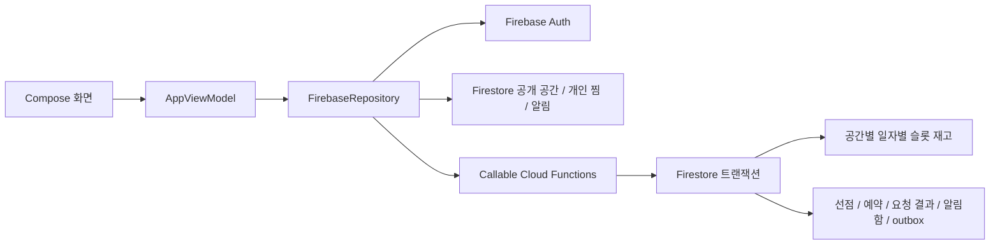

# 틈곳 · Little Space

시간이 필요한 만큼 공간을 찾고 예약하는 Android 포트폴리오 앱입니다. 제공된 **틈곳 기획서·화면정의서**를 기준으로 첫 번째 예약 MVP를 구현했습니다. 실제 공간 대여·과금은 하지 않습니다.

프로젝트 이름은 `com.포트폴리오.littlespace`, Android applicationId / namespace는 `com.portfolio.littlespace`입니다. Android 앱 ID에 한글을 쓸 수 없으므로 프로젝트 이름과 앱 ID를 구분했습니다. 런처 이름은 **틈곳**입니다.

## 구성

- Android: Kotlin 2.1.20, Jetpack Compose / Material 3, ViewModel, Repository, Coil
- 서버: Firebase Auth, Cloud Firestore, Node.js 22 Cloud Functions v2 (서울 리전)
- Android API 26 이상, compile / target SDK 35, Gradle Wrapper 8.11.1
- 기본 연결은 `demo-teumgot` Firebase Emulator입니다. Firebase 유료 프로젝트나 키 없이 빌드할 수 있습니다.



## 실행

### Android Studio

1. 이 저장소를 Android Studio에서 엽니다. JDK 21, Android SDK 35와 Build Tools 35.0.0을 설치합니다.
2. 로컬 터미널에서 Node.js 22와 Java를 준비하고 아래 서버 명령을 실행합니다.
3. Android Emulator에서 `app`을 실행합니다. 서버 주소는 기본 `10.0.2.2`입니다.

```bash
cd functions
npm ci
npm test
cd ..
./scripts/start-emulators.sh
```

별도 터미널에서 시드 데이터를 넣습니다. 명시한 두 변수가 있어야만 동작하며 실제 Firebase 프로젝트에는 실행할 수 없습니다.

```bash
cd functions
FIRESTORE_EMULATOR_HOST=127.0.0.1:8080 \
FIREBASE_AUTH_EMULATOR_HOST=127.0.0.1:9099 npm run seed
```

시드는 가상 공간 3곳과 **로컬 전용** 계정을 생성합니다. 재실행 시 해당 공간과 테스트 프로필을 갱신하며 예약 데이터를 지우지 않습니다.

| 역할 | 이메일 | 로컬 테스트 비밀번호 |
| --- | --- | --- |
| 고객 | `customer@teumgot.test` | `Teumgot123!` |
| 소유 운영자 | `host@teumgot.test` | `Teumgot123!` |

앱 회원가입으로 새 고객 계정을 만들어도 됩니다. 운영 권한은 Admin SDK가 발급한 `host` custom claim과 공간의 `hostId`를 모두 확인합니다. 가입 화면으로 권한을 올릴 수 없습니다.

실물 Android 기기는 USB 연결 후 `adb reverse tcp:8080 tcp:8080`, `adb reverse tcp:9099 tcp:9099`, `adb reverse tcp:5001 tcp:5001`을 실행하고 `-PemulatorHost=127.0.0.1`로 빌드합니다. 에뮬레이터 포트는 개발용이며 외부에 공개하지 마세요.

### 이 클라우드 환경

```bash
cd /workspace/little-space-android
source scripts/cloud-env.sh
./gradlew :app:assembleDebug :app:lintDebug
cd functions && npm test
```

APK: `app/build/outputs/apk/debug/app-debug.apk`

현재 머신의 전체 JDK·Android SDK·Node 22는 `/workspace/toolchains`에 있고 Gradle / npm / Emulator 캐시는 `/workspace` 아래에 둡니다. 시스템 Java는 컴파일러가 없는 JRE이므로 위 초기화가 필요합니다. 프록시 TLS 인증은 시스템 CA 저장소로 검증하며 인증서 검사를 끄지 않습니다.

### 통합 테스트

다른 에뮬레이터 프로세스를 종료한 뒤 실행합니다.

```bash
./scripts/test-integration.sh
```

Auth·Firestore·Functions를 실제 Firebase Emulator로 띄우고 시드 후 동시 선점, 중복 확정, 만료, 취소, Firestore 직접 쓰기 거절을 검사합니다. 네트워크에서 `storage.googleapis.com` 접근이 허용되어야 Emulator JAR를 처음 다운로드할 수 있습니다. 이 스크립트의 현재 실행 여부는 [검증 기록](docs/VALIDATION.md)에 별도로 기록합니다.

## Firebase 실제 프로젝트 연결

아직 실제 Firebase 프로젝트에 배포하지 않았습니다. 프로젝트 ID를 제공받지 않아 로컬 데모 프로젝트만 구성했습니다.

1. Firebase 프로젝트에 Android 앱 `com.portfolio.littlespace`를 등록합니다.
2. Authentication에서 Email/Password를 켜고 Firestore를 만듭니다. Cloud Functions 배포에는 결제 플랜 등 프로젝트 조건을 확인합니다.
3. 프로젝트의 공개 Android 설정을 **로컬** `~/.gradle/gradle.properties` 등에 넣습니다. 서비스 계정 키는 Android 앱에 넣지 않습니다.

```properties
firebaseProjectId=YOUR_PROJECT_ID
firebaseAppId=YOUR_ANDROID_FIREBASE_APP_ID
firebaseApiKey=YOUR_ANDROID_PUBLIC_API_KEY
useEmulators=false
```

4. 승인된 관리자 환경에서 `firebase deploy --project YOUR_PROJECT_ID --only firestore,functions`를 실행합니다. 이 저장소는 자동 배포하지 않습니다.
5. 운영 공간은 신뢰할 수 있는 Admin SDK 경로로 등록합니다. `functions/scripts/seed.js`는 실제 서버용 시드 도구가 아닙니다.

`google-services.json` 자동 처리 대신 `FirebaseOptions`로 설정을 초기화합니다. Firebase Android API 키는 앱 식별용 공개 설정이며 서비스 계정 비밀 키와 다릅니다. 실제 사용 시 API 제한·Firebase 보안 규칙·App Check 등 배포 구성을 별도로 검토해야 합니다.

## 구현 범위

| 문서 화면 / 기능 | 현재 구현 |
| --- | --- |
| SP-01~03 탐색·검색·상세 | 지역 직접 입력, 날짜·인원·유형·검색어 필터, 사진 대체 상태, 시설·규칙·후기 조회 |
| SP-04~07 시간·선점·확정·취소 | 30분 슬롯, 1~8시간, 5분 선점, 서버 가격 합산, 테스트 결제 성공·실패·3초 응답 지연, 예약 상세·취소 |
| SP-08~12 내역·찜·마이·알림·후기 | 예정·완료·취소 내역, 개인 찜, 로그아웃, 확정·취소 알림함, 완료 거래당 1회 후기 |
| SP-13 / 16~18 / 20 이메일 인증·비회원 | 게스트 탐색, 로그인 안내 시트, 이메일 로그인·가입·필수 동의, 비밀번호 재설정 메일, 로그인 후 원래 경로 복귀 |
| SP-14~15 운영 | 서버 소유권 및 custom claim 검사, 소유 공간 예약 조회, 시간 차단·해제 |
| 요청 복구 | 같은 요청 키·본문은 같은 결과, 본문 변경 거절, 미확정 예약 키를 기기에 저장하고 재조회 |

**아직 구현하지 않은 문서 항목:** Google Credential Manager·카카오·Apple 로그인 및 SP-21 소셜 가입, SP-19 앱 내부 새 비밀번호 화면(현재 Firebase 호스팅 재설정 흐름), FCM 전송·예약 알림·재시도 워커·기기 토큰 관리·SP-22 알림 설정, 지도 어댑터·길찾기, 전체 화면 스크롤 위치 복원, 목록 cursor 페이지네이션, Room 캐시, 시연 영상. 앱은 이 기능들이 동작하는 것으로 표시하지 않습니다. outbox는 확정·취소와 원자적으로 기록되지만 아직 소비하는 푸시 워커는 없습니다. 알림함은 FCM 없이 동작합니다.

문서 전체를 완성한 버전이나 실제 운영 서비스가 아닌 **핵심 예약 MVP**입니다. 실기기 UI·접근성·공급자 인증 검수는 별도 수행해야 합니다.

## 서버 계약

[Firebase 설계](docs/FIREBASE.md) · [검증 기록](docs/VALIDATION.md)

`functions/src/domain.js`는 시간·요금 규칙, `functions/src/index.js`는 인증·트랜잭션·idempotency를 담당합니다. 상태 변경은 클라이언트의 Firestore 직접 쓰기로 수행하지 않습니다. 앱 데이터 경로는 Compose → ViewModel → Repository → Firebase입니다.
