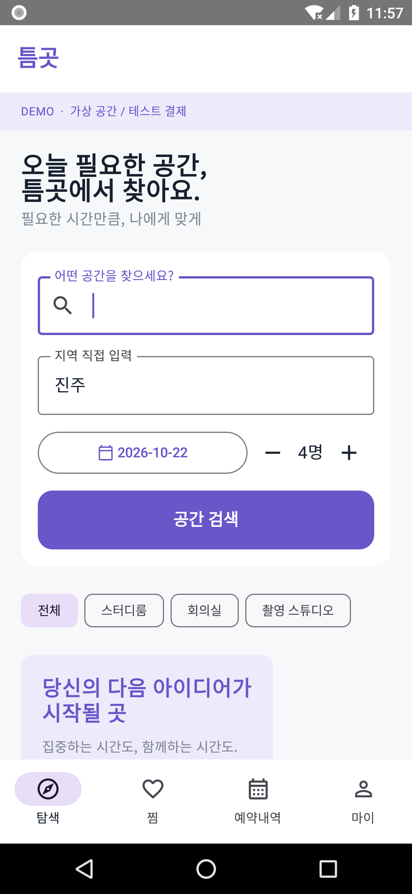
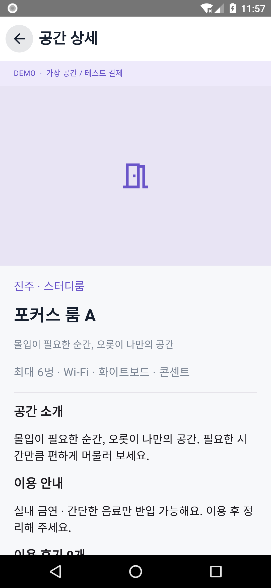
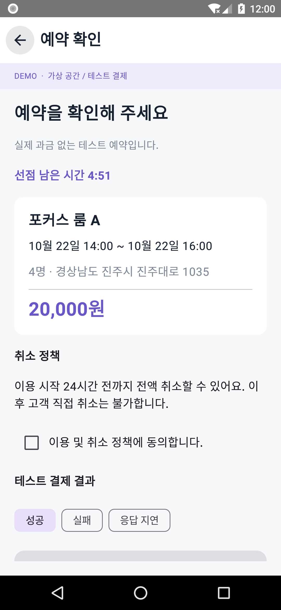
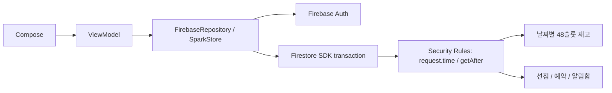

# 틈곳 · Little Space — Firebase Spark

필요한 시간만큼 공간을 찾고 예약하는 Android 포트폴리오 앱입니다. **Firebase Spark(무료) 기준으로 Auth + Cloud Firestore만 사용**합니다. Cloud Functions·Cloud Run·Cloud Storage·실제 결제 서버는 배포하지 않습니다.

프로젝트명 `com.portfolio.littlespace` · 앱 ID `com.portfolio.littlespace` · 표시 이름 **틈곳** · Android API 26 이상.

## 앱 화면

[전체 화면 스크린샷 14장](docs/screenshots/README.md) — 기존 0.1 버전의 debug 가상 데이터 촬영입니다. Spark 전환은 데이터 처리 구조를 바꾸며 화면의 주요 흐름은 유지합니다.

| 탐색 | 공간 상세 | 예약 확인 |
| --- | --- | --- |
| <a href="docs/screenshots/01-home.png"></a> | <a href="docs/screenshots/03-detail.png"></a> | <a href="docs/screenshots/11-confirm.png"></a> |

## Spark에서 제공하는 기능

- 비회원 탐색·검색·시설·후기 조회, 사진 URL 및 실패 대체 이미지
- 이메일 가입·로그인·재설정 메일, 필수 동의, 찜과 개인 내역
- **5분 선점, 30분 단위 1~8시간 예약, 정원·운영 시간·30분 고정단가 검사**
- Firestore 트랜잭션과 보안 규칙에 의한 중복 예약 방지·요청 결과 복구
- 서버 `request.time` 기준 선점 만료와 이용 24시간 전까지 취소
- 완료 예약당 후기 1회, 확정·취소 앱 알림함
- 소유 운영자의 예약 조회와 시간 차단·해제 (Admin custom claim 필요)

**제공하지 않는 기능:** 실제 과금·환불, 자동 FCM 발송·예약 알림·발송 워커, 사진 업로드/Cloud Storage, 휴대폰 SMS 인증, 외부 PG·카카오 custom-token 서버, 지도, 소셜 로그인. FCM 자체가 유료라서 제외한 것은 아닙니다. 자동 발송에 필요한 신뢰할 수 있는 서버를 이번 Spark 버전에서 운영하지 않습니다. 공간 사진은 외부 URL을 관리자가 등록합니다.

시간대별 변동 가격은 **30분 고정단가**로 단순화했습니다. 운영 가능한 날짜 재고는 관리자가 미리 등록합니다. 스케줄러 없이 종료 예약은 조회 시 완료로 표시하고, 만료된 선점은 정리 작업 없이 재사용합니다.

## 구조

Kotlin 2.1.20 · Jetpack Compose / Material 3 · ViewModel / Repository · Firebase Android SDK · Gradle 8.11.1 · JDK 21 · SDK 35.



앱의 검사는 안내용입니다. 앱을 변조해도 **배포된 보안 규칙**이 가격·정원·시간·권한·슬롯 변경을 검사합니다. 이전처럼 관리자 SDK가 모든 거래를 처리하는 서버는 없습니다. `firebase/`는 로컬 테스트·관리 도구이며 Cloud Functions 소스가 아닙니다.

## 로컬 실행

Android Studio에서 저장소를 열고 JDK 21, SDK 35 / Build Tools 35.0.0을 준비합니다. 별도 터미널에서 Node.js 22를 사용합니다.

```bash
npm --prefix firebase ci
./scripts/start-emulators.sh
```

다른 터미널에서 시드합니다. 이 명령은 **Auth·Firestore 두 에뮬레이터 변수 모두** 없으면 거절합니다. 기존 공간·재고·예약을 덮어쓰지 않으며 비어 있는 향후 30일만 생성합니다.

```bash
FIRESTORE_EMULATOR_HOST=127.0.0.1:8080 \
FIREBASE_AUTH_EMULATOR_HOST=127.0.0.1:9099 npm --prefix firebase run seed
```

| 로컬 전용 계정 | 이메일 | 테스트 비밀번호 |
| --- | --- | --- |
| 고객 | `customer@teumgot.test` | `Teumgot123!` |
| 소유 운영자 | `host@teumgot.test` | `Teumgot123!` |

앱을 Android Emulator에서 실행합니다. 기본 연결은 `demo-teumgot`, 호스트 `10.0.2.2`, Auth 9099 / Firestore 8080입니다. Functions용 5001 포트는 사용하지 않습니다. 실물 USB 기기는 두 포트를 `adb reverse`하고 `-PemulatorHost=127.0.0.1`로 빌드합니다.

### 클라우드 환경

```bash
cd /workspace/little-space-android
source scripts/cloud-env.sh
./gradlew :app:assembleDebug :app:lintDebug
```

APK: `app/build/outputs/apk/debug/app-debug.apk`.

Firestore JAR 다운로드가 차단되는 환경에서는 Google 공식 Cloud SDK 배포본을 사용할 수 있습니다. 검증된 배포본을 그대로 실행하며 JAR·서명을 수정하지 않습니다.

```bash
./scripts/install-firestore-emulator.sh
./scripts/start-emulators.sh
```

## 검증

```bash
# 다른 에뮬레이터를 먼저 종료하세요. 이 테스트는 로컬 test DB를 초기화합니다.
./scripts/test-integration.sh
```

실제 Firestore Emulator에 규칙을 올려 정상 거래와 공격 요청을 검증합니다. 기존 메모리 모형 테스트를 이 검증으로 대체했습니다. [검증 기록](docs/VALIDATION.md)에서 결과를 확인할 수 있습니다.

Android SDK 경로와 실제 Auth 연동까지 확인하는 테스트도 포함했습니다. 두 Firebase 에뮬레이터를 시작·시드한 뒤 Android 테스트 기기를 연결하고 실행합니다.

```bash
./gradlew :app:connectedDebugAndroidTest
```

## 실제 Spark 프로젝트 연결

1. Firebase 콘솔에서 **Spark** 프로젝트에 Android 앱 `com.portfolio.littlespace`를 등록합니다.
2. Email/Password Auth와 Cloud Firestore를 활성화합니다. 신뢰할 수 있는 관리자 환경에서 **보안 규칙·인덱스만** 배포합니다.

```bash
firebase/node_modules/.bin/firebase deploy --project YOUR_PROJECT_ID --only firestore
```

3. Firebase 콘솔에서 받은 `google-services.json`을 `app/`에 넣고 다시 빌드합니다. 또는 로컬 Gradle 속성(예: `~/.gradle/gradle.properties`)에 Android 공개 설정을 넣습니다. 서비스 계정 키는 앱·저장소·채팅에 넣지 않습니다.

```properties
firebaseProjectId=YOUR_PROJECT_ID
firebaseAppId=YOUR_ANDROID_FIREBASE_APP_ID
firebaseApiKey=YOUR_ANDROID_PUBLIC_API_KEY
useEmulators=false
```

4. 관리자가 공간과 운영일을 등록하고 운영자 계정에 custom claim을 지정합니다. [Spark 운영·전환 안내](docs/SPARK.md)를 따릅니다.

실제 프로젝트 ID·설정이 제공되지 않아 라이브 배포는 하지 않았습니다. `app/google-services.json`에서 현재 Android 패키지에 맞는 설정을 읽어 `FirebaseOptions`에 적용합니다. 파일은 Git에서 제외됩니다. 기존 Functions 버전의 데이터는 자동 변환하지 않습니다. 원본을 삭제하지 않고 새 `spark*` 컬렉션을 사용합니다.

[Firebase 계약·보안 설계](docs/FIREBASE.md) · [Spark 한도·관리 절차](docs/SPARK.md) · [검증 기록](docs/VALIDATION.md)

### 실제 Firebase 회원가입 연결

1. Firebase 콘솔에서 Android 앱을 패키지명 `com.portfolio.littlespace`로 등록합니다.
2. 내려받은 `google-services.json`을 `app/google-services.json`에 넣습니다. 설정 파일이 있으면 실제 서버를 자동 선택합니다. 위 Gradle 속성은 파일보다 우선하므로 예전 `useEmulators=true` 설정은 제거합니다.
3. Authentication → Sign-in method에서 이메일/비밀번호를 활성화하고 Firestore 데이터베이스를 생성합니다. 저장소의 보안 규칙·인덱스를 해당 프로젝트에 배포합니다.
4. 앱을 다시 빌드해 설치합니다. 이미 설치한 데모 APK에는 새 설정이 적용되지 않습니다.

설정이 없으면 기존 개발용 에뮬레이터 모드입니다. Android 에뮬레이터는 `10.0.2.2`, USB 실기기는 `adb reverse tcp:9099 tcp:9099`와 `adb reverse tcp:8080 tcp:8080` 후 `-PemulatorHost=127.0.0.1`로 빌드합니다. 로컬 Firebase 서버도 실행해야 합니다.
