# 앱 화면 스크린샷

실제 Android 에뮬레이터에서 실행한 Jetpack Compose 화면의 전체 화면 캡처입니다. PNG는 자르거나 합성하지 않은 원본입니다. 각 이미지를 클릭하면 전체 해상도로 볼 수 있습니다.

촬영 환경: Android 8.0 / API 26, 1080 × 2340 px, 440 dpi. 하드웨어 가속 없이 실행했습니다. 촬영일: 2026-10-21 (한국 시각). 회원 유형 선택이 추가된 회원가입 화면(09)은 2026-10-22에 다시 촬영했습니다.

Firebase Emulator와 사진 서버 접근이 차단되어 **debug 전용 `ScreenshotActivity`의 오프라인 가상 데이터**를 사용했습니다. 사진 영역은 앱에 구현된 대체 이미지 상태입니다. 예약 확인·상세·취소 화면의 거래도 촬영용 데이터이며, 이 이미지는 실제 Firebase 거래·인증 검증 결과를 의미하지 않습니다. 실제 서버를 사용하는 기본 `MainActivity`의 예약 처리는 변경하지 않았습니다. 촬영 Activity와 샘플 데이터는 release 빌드에 포함되지 않습니다.

| 탐색 | 검색 결과 | 공간 상세 |
| --- | --- | --- |
| <a href="01-home.png"></a> | <a href="02-search.png">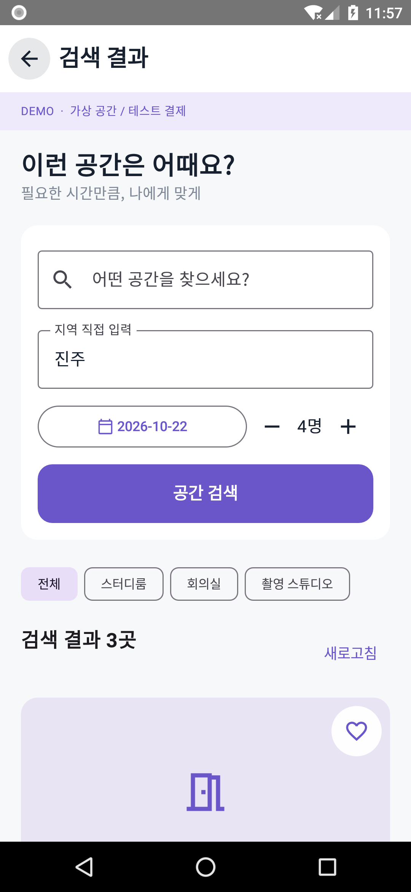</a> | <a href="03-detail.png"></a> |

| 시간 선택 | 비회원 찜 | 비회원 예약내역 |
| --- | --- | --- |
| <a href="04-time.png">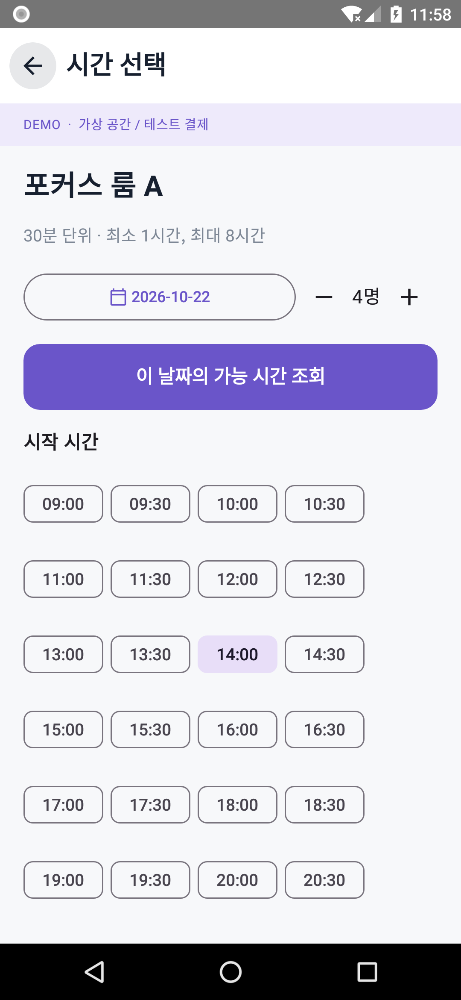</a> | <a href="05-favorites.png">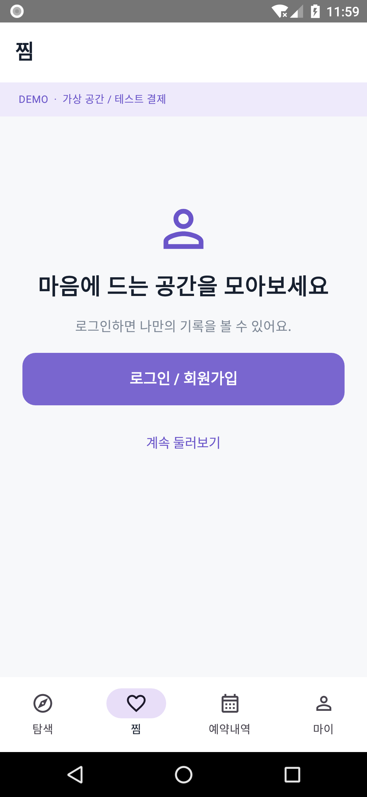</a> | <a href="06-bookings.png">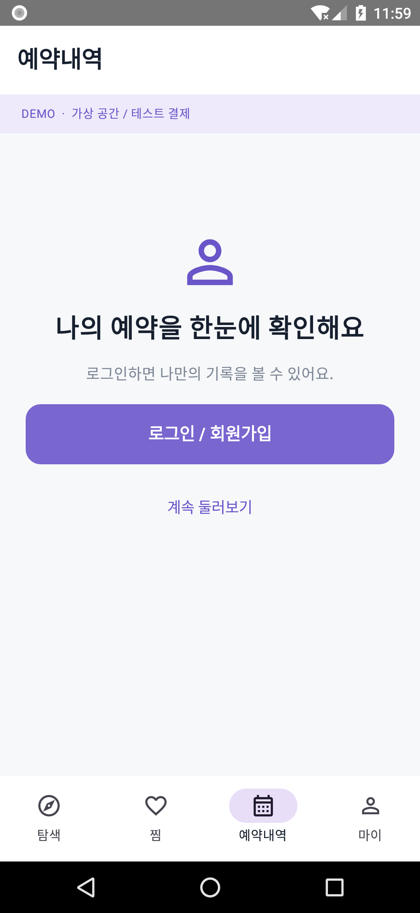</a> |

| 비회원 마이 | 로그인 | 회원가입 |
| --- | --- | --- |
| <a href="07-my.png">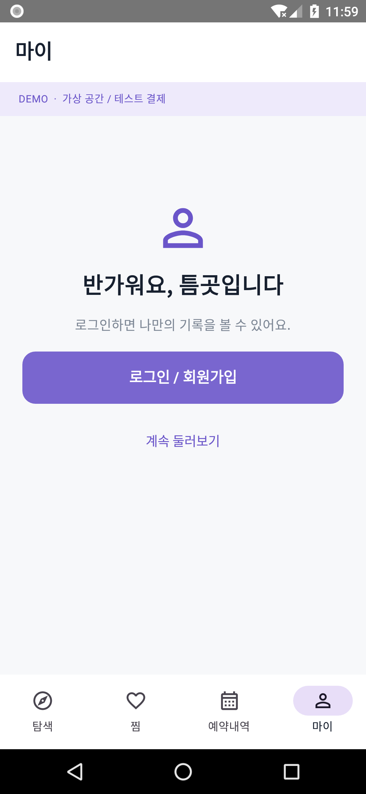</a> | <a href="08-login.png">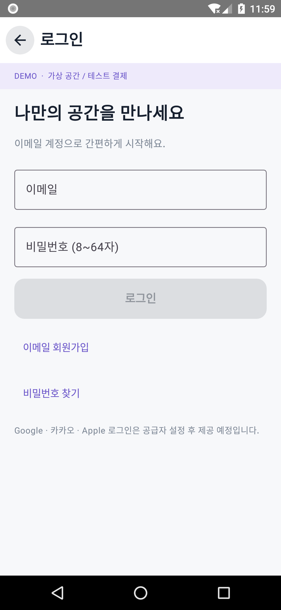</a> | <a href="09-signup.png">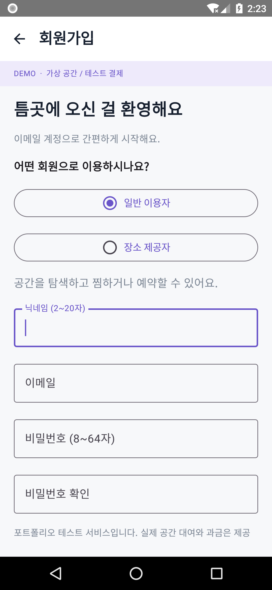</a> |

| 비밀번호 재설정 | 예약 확인 | 예약 상세 |
| --- | --- | --- |
| <a href="10-reset.png">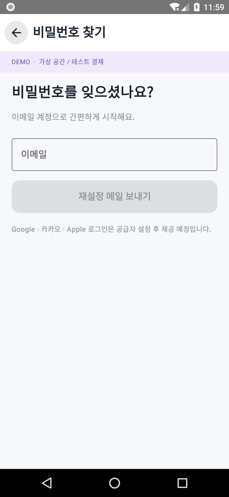</a> | <a href="11-confirm.png"></a> | <a href="12-booking.png">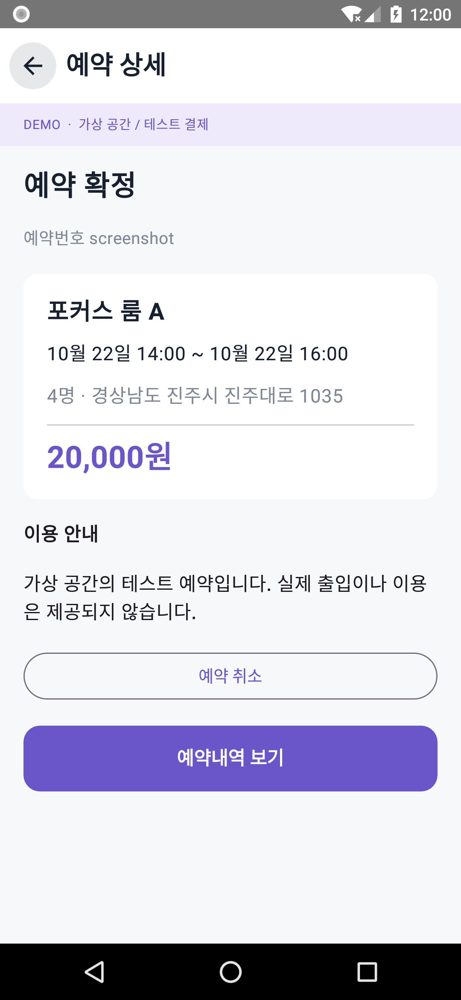</a> |

| 예약 취소 | 후기 작성 |
| --- | --- |
| <a href="13-cancel.png">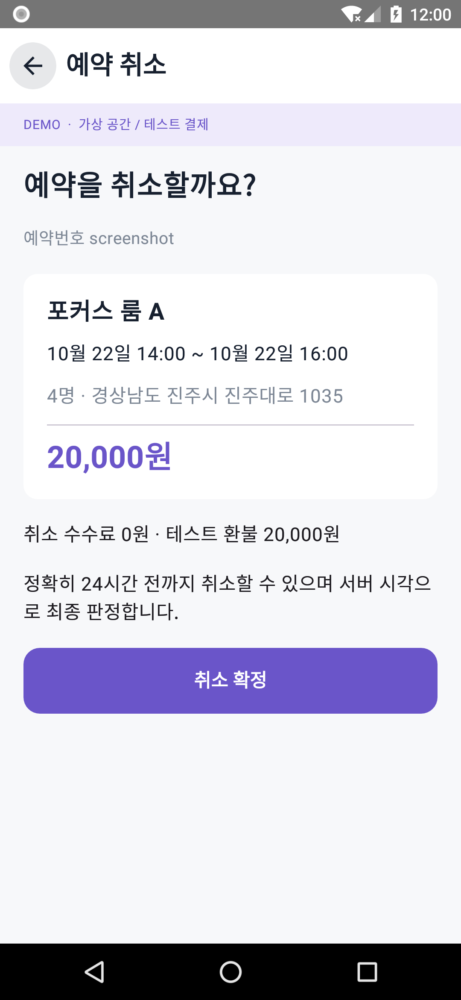</a> | <a href="14-review.png">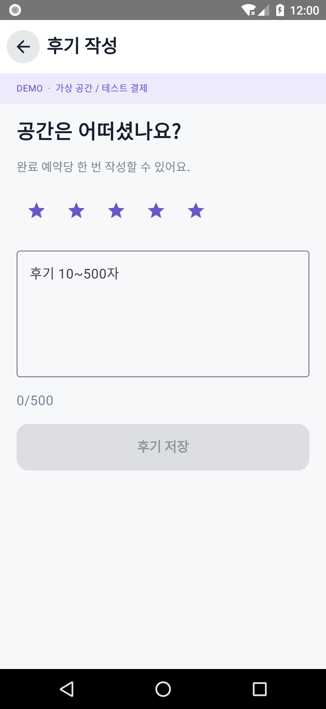</a> |

## 다시 촬영하기

Android 에뮬레이터나 테스트 기기를 연결하고, debug APK를 빌드한 뒤 실행합니다. 전용 기기에서만 실행하세요. 스크립트는 해당 앱을 재설치·재시작하고 기기의 화면 애니메이션을 끕니다. 앱 데이터와 계정을 초기화하지는 않습니다.

```bash
./gradlew :app:assembleDebug
adb devices
python3 scripts/capture-screenshots.py --serial emulator-5554
```

상태 표시줄·시스템 탐색바도 포함하므로 사용한 Android 기기에 따라 바의 모양과 해상도는 달라질 수 있습니다. 긴 화면은 최초 스크롤 위치의 실제 뷰포트를 촬영합니다. 전체 스크롤 내용을 하나로 합친 이미지는 아닙니다.
